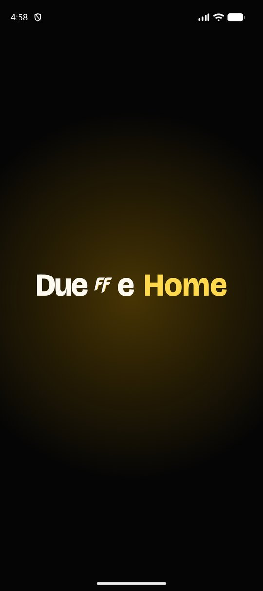
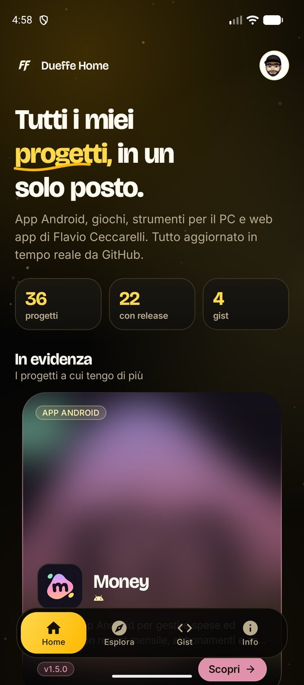
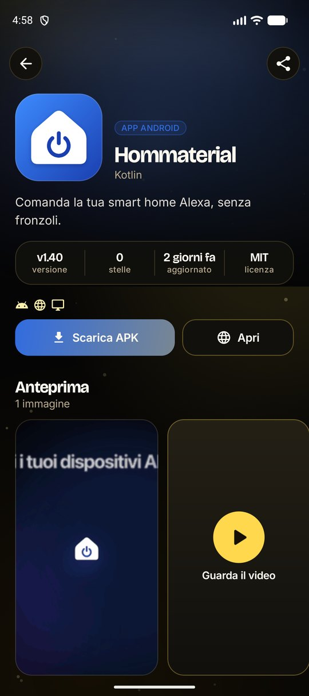
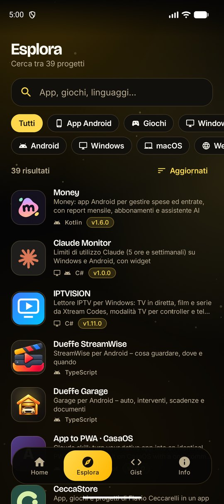
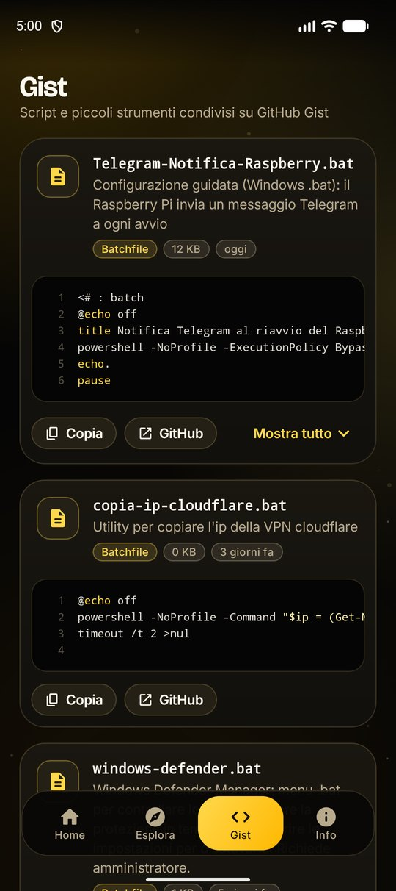

# Dueffe Home

**Tutti i progetti di Flavio, in un solo posto.**

Un piccolo store personale, nativo per Android e identico sul web, che raccoglie app, giochi, strumenti e gist pubblicati su [GitHub](https://github.com/carellice).

  
  
  
  
  

## Cosa trovi

- **Home**: i progetti in evidenza in un carosello 3D, le categorie, le ultime release e una riga per ogni tipo di progetto.
- **Esplora**: ricerca istantanea, filtri per categoria e piattaforma, ordinamento per data, nome o stelle.
- **Scheda progetto**: icona, descrizione, screenshot a schermo intero con zoom, funzionalità, note dell'ultima release, file da scaricare e tutti i link utili.
- **Gist**: gli script pubblicati su GitHub Gist con anteprima evidenziata, copia negli appunti con un tocco.
- **Info**: aggiornamenti in-app, profilo e link.

Il catalogo si genera da solo: ogni giorno una GitHub Action legge repository pubblici, release e gist e pubblica `catalog.json` insieme al sito. L'app lo scarica all'avvio e ne tiene una copia per l'uso offline.

## Animazioni

Splash «Dueffe + Home» dal design system Dueffe con apertura circolare, fondale con nebulose dorate e pulviscolo, titolo che entra parola per parola con sottolineatura disegnata a mano, numeri che contano, carosello con rotazione 3D, parallasse e alone che percorre il bordo, icona condivisa tra lista e dettaglio, barra di navigazione con indicatore "liquido", pressioni a molla ovunque.

## Aggiornamenti in-app

In **Info → Controlla aggiornamenti** l'app legge l'ultima release di questa repository, scarica l'APK allegato mostrando l'avanzamento e apre l'installazione di Android. Quando c'è una versione nuova compare anche un banner in Home.

## Versione web

[carellice.github.io/dueffe-home](https://carellice.github.io/dueffe-home/) riproduce l'app 1:1 in HTML, CSS e JavaScript senza dipendenze: stesse schermate, stessi colori, stesse animazioni. Si può installare come PWA.

## Struttura

| Percorso | Contenuto |
|---|---|
| `app/` | App Android (Kotlin, Jetpack Compose, Coil) |
| `web/` | Versione web |
| `tools/build-catalog.mjs` | Generatore del catalogo dai dati GitHub |
| `tools/catalog-overrides.json` | Categorie, progetti in evidenza, nomi e piattaforme corretti a mano |
| `catalog/catalog.json` | Copia del catalogo inclusa nell'APK |
| `rilascia.bat` | Pubblica una nuova release |
| `DS.md` | Design system Dueffe: token, tipografia, movimento e componenti da riusare in altre app |

## Pubblicare una release

Doppio clic su **`rilascia.bat`**. Lo script:

1. incrementa la versione (`rilascia.bat minor` o `major` per salti più grandi);
2. aggiorna il catalogo incluso nell'APK;
3. compila l'APK firmato;
4. crea commit e tag, li invia a GitHub e pubblica la release con l'APK allegato.

Serve la cartella privata `.release/` con la chiave di firma (`dueffe-home.jks` e `signing.properties`): non è nel repository, va conservata con un backup. Senza la stessa chiave Android rifiuta gli aggiornamenti.

Requisiti sul PC: Git, GitHub CLI autenticata, JDK 17+, Node.js e Android SDK.

## Licenza

MIT — Flavio Ceccarelli
